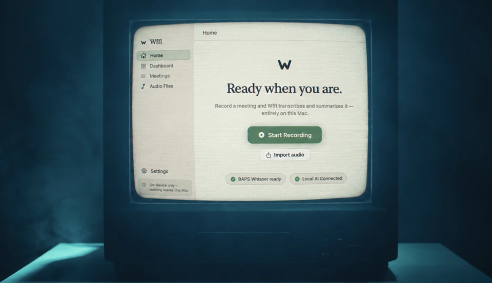
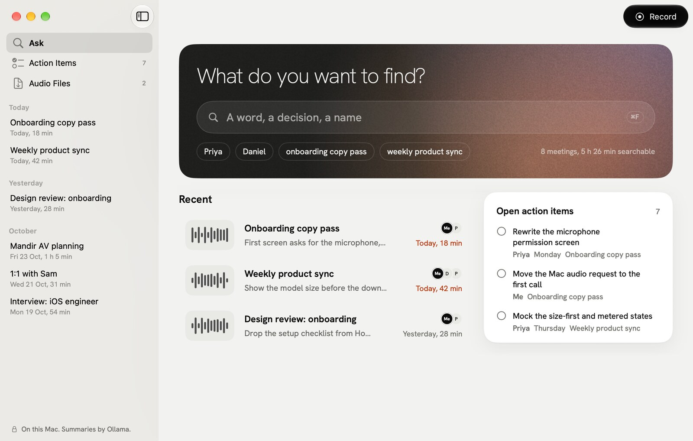
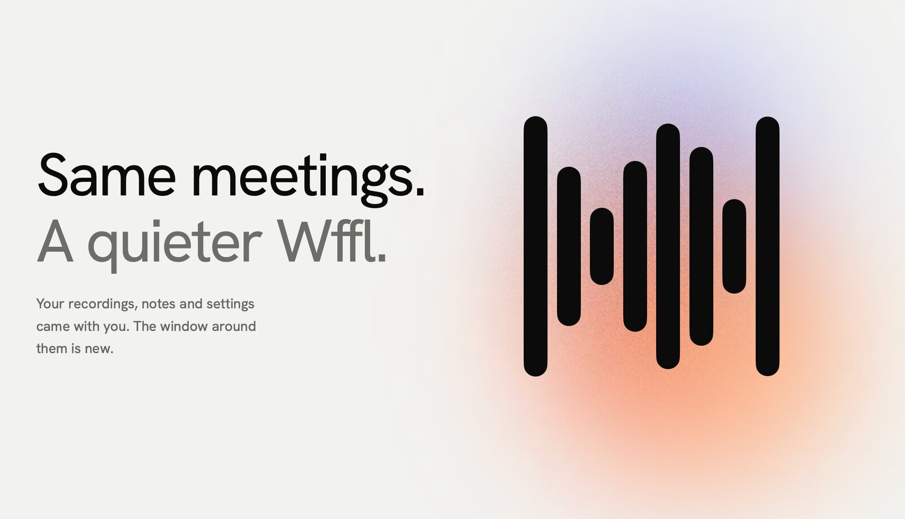
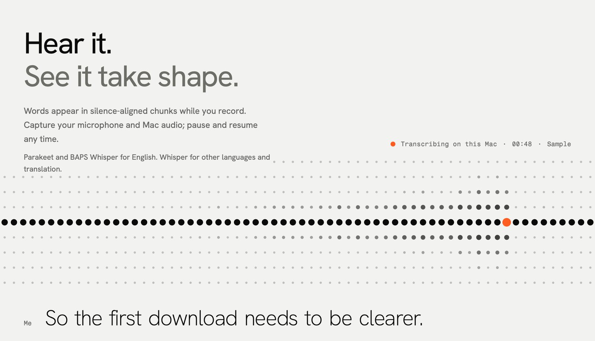
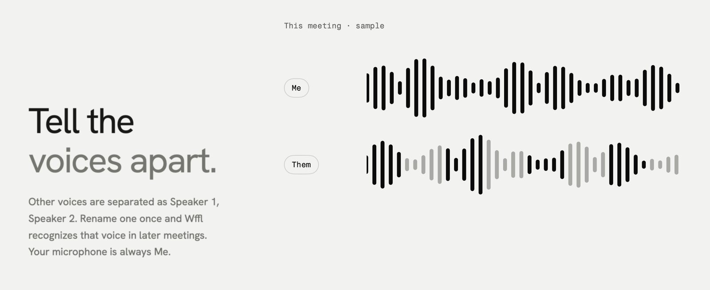
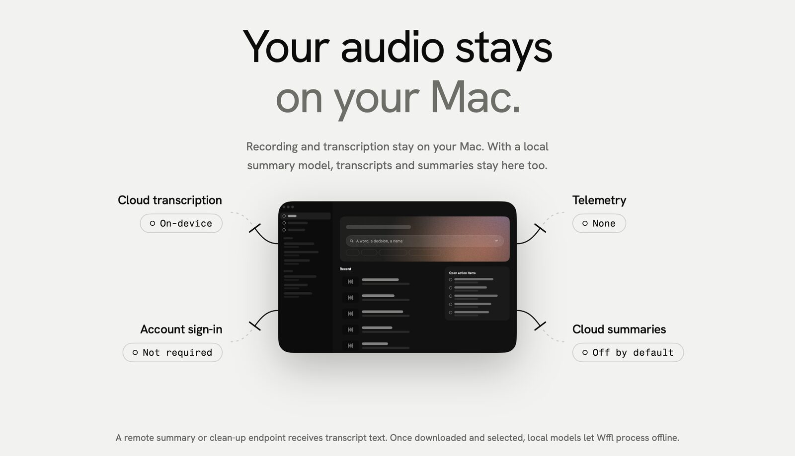

<p align="center">
  <a href="https://wffl-silk.vercel.app">
    <picture>
      <source media="(prefers-reduced-motion: reduce)" srcset="docs/assets/v2/hero-opening-poster.jpg">
      
    </picture>
  </a>
</p>

<p align="center">
  <strong>Record, transcribe and search your meetings. All on your Mac.</strong>
</p>

<p align="center">
  <strong><a href="https://github.com/PurvarajG/Wffl/releases/latest">Download Wffl for Mac</a></strong> · free · macOS 15+ · Apple Silicon
</p>

<p align="center"><sub>
  <a href="https://wffl-silk.vercel.app">Website</a> ·
  <a href="#get-wffl">Get started</a> ·
  <a href="#privacy">Privacy</a> ·
  <a href="#build-from-source">Build</a>
</sub></p>

<p align="center">
  
  
  
  
</p>

---

## Wffl 2.0

**I agree. Let's change that.** Wffl 2.0 is a new macOS interface built around search: one place to find what was said in any meeting, with your open action items beside it.

<picture>
  <source media="(prefers-color-scheme: dark)" srcset="docs/assets/v2/app-ask-dark.jpg">
  
</picture>
<p align="center"><sub>The new Ask page, shown with sample meetings.</sub></p>

## Ask

Ask is search, not a chatbot. Type a word, a name or a decision, and Wffl looks through meeting titles, notes, summaries and transcripts. A match opens the transcript at that line, with the recording cued.

Press **⌘F** on the Ask page to jump to the search field.

## The new window

<picture>
  <source media="(prefers-color-scheme: dark)" srcset="docs/assets/v2/tour-quieter-dark.jpg">
  
</picture>

A sidebar holds Ask, Action Items, Audio Files and your meetings by day. Each meeting is one page with Summary, Transcript and Notes, and an inspector for speakers and recording details. Play the recording from that page, with a waveform read from the audio file. It all comes in light and dark.

## Live transcription

<picture>
  <source media="(prefers-color-scheme: dark)" srcset="docs/assets/v2/tour-hear-dark.jpg">
  
</picture>

Wffl records your microphone and the call's system audio together, and transcribes on your Mac while the meeting runs. Record in the main window. Mute the mic, take timestamped notes, and press **⌘B** to bookmark a moment. You can also import an audio file and transcribe it the same way.

| Engine | Languages | Notes |
| :--- | :--- | :--- |
| **BAPS Whisper** | English | Built for English conversations that include Gujarati and Sanskrit terms. |
| **Parakeet** | English | An English-only alternative. |
| **Whisper** (whisper.cpp) | Many languages | Also translates to English. Wffl uses Whisper whenever you pick another language or turn on translation. |

## Speakers

<picture>
  <source media="(prefers-color-scheme: dark)" srcset="docs/assets/v2/tour-voices-dark.jpg">
  
</picture>

Rename a voice once, and Wffl recognizes it in later meetings. It only matches voices you have named, so a new voice stays a numbered speaker.

Speaker labels run on your Mac after the recording ends, using a speaker model you download once in Settings. They need the call's system audio, since your own microphone is never split up.

## Summaries and action items

Summaries and transcript clean-up use Ollama by default, or a self-hosted endpoint. Hosted providers are optional and off by default.

Open items from your summaries collect in Action Items. Tick one off and the summary updates. Export or copy what you need.

## Privacy

<picture>
  <source media="(prefers-color-scheme: dark)" srcset="docs/assets/v2/tour-private-dark.jpg">
  
</picture>

No account. No telemetry.

If you choose a hosted provider, it receives the transcript text needed for that request. API keys for hosted providers are kept in your Keychain. macOS controls access to your microphone and system audio; you can review it in System Settings.

<details>
<summary>Where your data lives</summary>

```text
~/Library/Application Support/Wffl/
├── wffl.sqlite        # Meetings, transcripts, notes, summaries, speakers and their voice embeddings
├── recordings/        # One audio file per meeting, plus which channel was speaking when
└── models/
    ├── ggml-*.bin     # Whisper models you downloaded, and a small voice-activity model
    └── baps-whisper/  # BAPS Whisper, if you downloaded it
```

Transcription models are downloaded when you install them in Settings. The small voice-activity model downloads itself the first time it is needed. Parakeet and the speaker model are downloaded and cached by FluidAudio in `~/Library/Application Support/FluidAudio/Models/`. Ollama keeps its own models.

</details>

<a id="first-run"></a>
## Get Wffl

Wffl runs on **Apple Silicon Macs with macOS 15 or later**. Download the latest signed release from [GitHub Releases](https://github.com/PurvarajG/Wffl/releases/latest), open the DMG, and drag Wffl to Applications.

1. Grant microphone access when prompted. Allow Screen & System Audio Recording if you want to capture the other side of a call.
2. Open Settings and download a transcription model. BAPS Whisper is approximately 1.6 GB; its first load can take a few minutes. Parakeet and Whisper are alternatives.
3. To make local AI summaries, install [Ollama](https://ollama.com), download a model, and select it in Wffl's settings. Summaries are optional; transcription does not require Ollama.

Wffl does not update itself yet. To update, download the newest DMG from GitHub Releases and replace the app in Applications.

<details>
<summary><strong>Coming from Meetily or Wffl 1.x?</strong></summary>

**Wffl 1.x.** Replace the app in Applications. Your meetings, recordings, notes and settings stay where they were; Wffl keeps them outside the app. Models you downloaded are kept there too.

**Meetily for macOS.** On first launch, Wffl adopts Meetily's existing local data folder and preferences. It moves the old `MeetilyMac` folder into place when no `Wffl` folder exists yet, renames the old database, and repoints saved recordings to the new folder.

</details>

## Keyboard shortcuts

| Action | Shortcut |
| :--- | :--- |
| New meeting and record | **⌘N** |
| Import an audio file | **⌘I** |
| Pause or resume recording | **⇧⌘P** |
| Mute or unmute the microphone | **⇧⌘M** |
| Stop and save the recording | **⇧⌘S** |
| Bookmark this moment in the notes, while recording | **⌘B** |
| Search, on the Ask page | **⌘F** |
| Settings | **⌘,** |

## Build from source

Requires an Apple Silicon Mac, macOS 15 or later, and Swift 6.2 or later. Run the tests with `swift test`.

<details>
<summary>Build steps</summary>

```bash
git clone https://github.com/PurvarajG/Wffl.git
cd Wffl
WFFL_APP_PATH="$PWD/dist/Wffl.app" ./scripts/bundle.sh release
open dist/Wffl.app
```

`scripts/bundle.sh` signs the app with a certificate named "Wffl Dev" by default. Create a self-signed code-signing certificate with that name in Keychain Access, or set `WFFL_SIGN_IDENTITY` to another identity. For release signing, see [release signing](docs/release-signing.md).

To package a local DMG, run `./scripts/make-dmg.sh dist/Wffl.app dist/Wffl.dmg`.

</details>

<details>
<summary>Under the hood</summary>

**SwiftUI + AppKit**, built with Swift Package Manager. Transcription runs on [whisper.cpp](https://github.com/ggml-org/whisper.cpp) and [WhisperKit](https://github.com/argmaxinc/WhisperKit) (BAPS Whisper); Parakeet and speaker labels run on [FluidAudio](https://github.com/FluidInference/FluidAudio). See [architecture](docs/architecture.md) for how the app is put together.

```text
Sources/
├── Wffl/
│   ├── Audio/          # Microphone and system audio capture, mixing, the recorder
│   ├── Transcription/  # BAPS Whisper, Parakeet, whisper.cpp, chunking, voice activity
│   ├── Diarization/    # Speaker labels and the voice library
│   ├── LLM/            # Summaries and transcript clean-up providers
│   ├── Database/       # The local SQLite library
│   ├── Views/          # Ask, the meeting page, the live session, Settings
│   ├── Welcome/        # The opening film and What's New
│   └── Support/        # Preferences, Keychain, theme, fonts
├── CWhisper/           # C shim for whisper.cpp
└── WfflPrototype/      # The 2.0 design prototype
Tests/WfflTests/
scripts/                # bundle.sh, make-dmg.sh
```

</details>

## Contributing

Found a problem or have an idea? [Open an issue](https://github.com/PurvarajG/Wffl/issues) with the steps to reproduce it and your macOS version. Run `swift test` before opening a pull request.

## License

[MIT](LICENSE). Wffl is based on [Meetily](https://meetily.ai) by Zackriya Solutions, and includes open-source speech and audio components: whisper.cpp, WhisperKit and FluidAudio.

Maintainers: see [docs/RELEASING.md](docs/RELEASING.md).

---

<p align="center">
  Wffl 2.0 is free and open source.<br>
  <strong><a href="https://github.com/PurvarajG/Wffl/releases/latest">Download Wffl for Mac</a></strong>
</p>

<p align="center">
  <sub>Made by <a href="https://github.com/PurvarajG">Purvaraj</a>.</sub>
</p>
